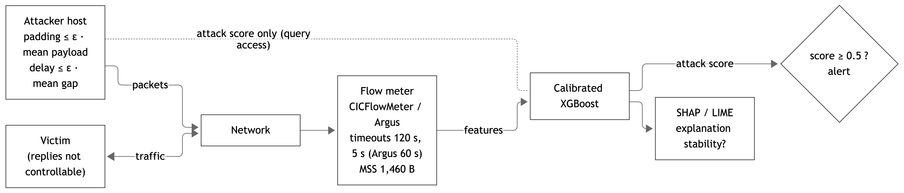

# Evasight

**Do explanations of a network intrusion detector stay stable under realistic evasion?**

Evasight attacks flow-based intrusion detectors the way a real attacker could: by padding the payload of its own packets and delaying them, never by editing feature values directly. Every feature that depends on those packets is recomputed, and every perturbed flow must still be one the flow meter could have produced. We then ask whether SHAP and LIME explanations stay stable under such attacks, and whether their instability can reveal an evasion.



## What is in this repository

- **Problem-space attacks** for CICFlowMeter features (CIC-IDS2017, CSE-CIC-IDS2018) and Argus/Zeek features (UNSW-NB15): padding and delay with budgets relative to each flow, flow-meter timeouts measured from the data (120 s and 5 s for CICFlowMeter, 60 s for Argus), validity rules that clean traffic satisfies, and feature controllability tables (`configs/`).
- **Leak-aware splits**: conflicting labels dropped, duplicate feature vectors removed, no feature vector in two partitions, per-class time blocks for the CIC datasets, and metadata such as the capture day kept out of the model.
- **Calibrated XGBoost baselines** and a reproducible attack runner.
- **Explanation stability** (SHAP, LIME) and an instability-based evasion detector: in progress.

## Results so far

Test split, calibrated XGBoost, evasion = share of detected attacks whose score falls below 0.5 after the attack.

| Dataset | Features | AUC | Evasion at ε = 0.1 | Evasion at ε = 1.0 |
|---|---|---|---|---|
| CIC-IDS2017 (improved) | 79 | 0.9988 | 0.06% | 0.15% |
| UNSW-NB15 | 42 | 0.9661 | 2.08% | 5.46% |
| CSE-CIC-IDS2018 (improved) | 79 | 1.0000 | 0.00% | 0.04% |

The weaker the baseline, the easier the evasion. On CIC-IDS2017, most evasions are slow DoS attacks. On CSE-CIC-IDS2018 the near-perfect score partly comes from the TCP initial window size, which fingerprints the attackers' operating system: a shortcut that padding and delay cannot touch, and one we report rather than hide.

## Data

We use the improved releases of CIC-IDS2017 and CSE-CIC-IDS2018 by Liu et al. (IEEE CNS 2022), available from the [project page](https://intrusion-detection.distrinet-research.be/CNS2022/), and the official training and testing sets of UNSW-NB15. The data is not redistributed here. SHA-256 checksums of the files we used are in `docs/`.

## Reproduce

```bash
python3.12 -m venv .venv && source .venv/bin/activate
python -m pip install -e ".[dev]"

# UNSW-NB15: load, split, train, attack
python -m evasight.data.loaders unsw
python -m evasight.data.split unsw
python -m evasight.models.gbdt unsw
python -u scripts/run_attack.py --data data/processed/unsw_nb15/test.parquet --tag xgb_unsw --out artifacts/unsw_v2

# CIC-IDS2017 (improved): split, train, attack
python -m evasight.data.split
python -m evasight.models.gbdt
python -u scripts/run_attack.py --out artifacts/v5

# CSE-CIC-IDS2018 (improved): load, split, train, attack
python -m evasight.data.loader_cic2018_improved load 0.1
python -m evasight.data.split cic2018
python -m evasight.models.gbdt cic2018
python -u scripts/run_attack.py --data data/processed/cic_ids2018_improved/test.parquet --tag xgb_cic2018_improved --out artifacts/cic2018_improved

# Check that every processed dataset is ready for modelling
python scripts/check_ready.py
```

Results are deterministic: the same commands reproduce the same numbers. Progress and decisions are logged in `docs/STATUS.md`.

## Authors

Likhith (threat model, data, attacks) and Sharath (models, explanations, evaluation).

## Status

Work in progress. A preprint is in preparation.
